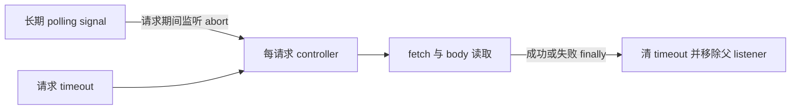

# 修复长期 polling 的 signal 登记记录累积

## 问题与证据

每个 ACP adapter 持有长期存活的 polling AbortController。`IlinkClient.post` 每轮通过 `AbortSignal.any([parent, timeout])` 组合信号。在 Node 22.23.4 中，`sourceSignalsCleanupRegistry` 按源 signal 注册回收记录；长期父 signal 不被回收时，WeakCell、登记对象和 WeakRef 会按调用次数累积，即使请求和组合 signal 已结束。

本机 Node 22.23.4 合成实验：20 万次请求、650 个父 signal、32 并发，每批 GC 后，实际 SDK + OTel 的 heap 从约 21 MiB 增至 54 MiB；只改 signal 连接方式后稳定在约 20 MiB。纯 `AbortSignal.any` 也能复现，heap snapshot 的持有变量为 `sourceSignalsCleanupRegistry`。这是本机 macOS 实验，不能替代使用方 Linux 部署后的长时间验收。

## 改动范围与语义

只改 `IlinkClient.post`：fetch 使用每请求 AbortController 的 signal；用显式 listener 将父 signal 的 abort 原因转发到 controller；在 `finally` 同时清 timeout 和移除父 listener。

- 父 signal 已取消：传给 fetch 的 signal 立即保持同一 abort reason。
- 请求或 body 读取期间取消：立即转发；listener 保持至 body 读取结束。
- timeout：保持现有 30 秒长轮询超时及 `getUpdates` 对 AbortError 的处理。
- 成功、网络/HTTP/解析/body 错误、取消、timeout 均释放 listener 和 timer；同一父 signal 可继续用于后续请求。
- 不改 polling 调度、重试、持久化、接口、运行配置或全局 AbortSignal；不手工编辑 dist。

## 验证与发布

针对性测试覆盖重复成功请求的 listener 不累积、已取消和请求中取消、body 读取期间的生命周期、失败路径与 timeout 清理；执行 typecheck 和 build。对本分支构建产物复跑同版本 localhost 内存实验，保留原实现对照。原始 heap/日志不提交。

增加 patch changeset，走仓内现有发布流程。此 PR 不发布 npm、不更新使用方依赖、不部署；使用方升级后须观察 RSS/heap 与内存增长斜率。

第一方源码：[Node 22.23.4 abort_controller.js](https://github.com/nodejs/node/blob/v22.23.4/lib/internal/abort_controller.js#L293)。

## 本分支验证结果

- 全部 183 个单元/模拟集成测试通过；typecheck、build 通过。
- 对本分支实际 build 产物复跑 Node 22.23.4 + OTel、20 万次 localhost 请求：每批 GC 后 heap 从 1 万次时 19.38 MiB 到 20 万次时 19.67 MiB，最终 GC 后 19.60 MiB；20 万个 Span 均已结束。
- 同条件原实现约 21.19 → 53.81 MiB。实验仅在 macOS arm64 上执行，不宣称 Linux 或生产长时间验收通过。
