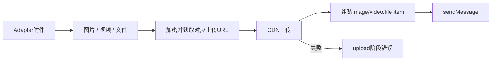

# 将使用方媒体 patch 收回 SDK

目标：SDK 原生支持 Youniverse 现有媒体补丁的行为，使使用方可升级版本后删除编译产物 patch。本 PR 只修改 SDK 源码、测试、文档和 patch changeset，不编辑 dist、不直接删除使用方仍依赖的补丁。

## 行为与数据归属

- `postMessage` 将图片、视频和普通文件上传到 iLink CDN，再组装 image/video/file item。上传协议类型分别为1/2/3；消息 item 使用现有 `MessageItemType`，两类枚举不可混用。
- `SendMessageParams.media` 由 adapter 写、client 的 body builder 读，不持久化。CDN凭据和ciphertextSize来自上传结果；文件名来自附件，rawSize从实际buffer长度计算，用于file_item.len。视频不冗余携带未消费的文件名/rawSize。
- 保持图片现有上传行为；视频和文件的每次CDN上传最多60秒，保留既有三次重试。上传失败继续抛错，保留 `wechatDeliveryStage='upload'` 兼容标记，绝不在上传失败后继续sendMessage。
- `stopTyping` 发送 iLink 官方停止状态2；启动typing保持原行为。媒体payload在tokenless重试时必须保留。
- 保留现有public `uploadImage` 的两参数接口，内部复用三类媒体的上传实现。不改polling、signal修复、业务鉴权或存储。

验证：mocked fetch覆盖三类media_type、消息body、文件原始长度、视频密文长度、60秒timeout、失败不发送、typing停止、tokenless重试媒体保留。全部单测/typecheck/build通过后，对照原使用方patch列出等价行为。

发版：增加patch changeset，预计下一版本0.3.6。合并并发布后，使用方再升级SDK、更新lockfile、删除0.3.4/0.3.5媒体patch及root登记；需要同时覆盖仍使用0.3.4的调用方，不能提前删除导致已有媒体能力丢失。

## 验证结果与来源

191个测试、typecheck、build通过；包含新增8个模拟媒体交付用例。未做真实微信发送或手机呈现E2E。

腾讯第一方类型定义确认UploadMediaType与MessageItemType数值不同，以及typing开始1、取消2：[协议类型](https://github.com/Tencent/openclaw-weixin/blob/main/src/api/types.ts)。本轮迁移使用方既有payload行为，mock校验不代表完整服务端契约验收。
